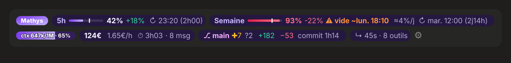

# claude-kit

**Personnalisation complète de Claude Code, en français.** Une bande d'infos au-dessus du prompt, une statusline pour le terminal, des garde-fous de sécurité, des notifications, du formatage automatique, 11 commandes et 4 agents. Tout se règle depuis Claude avec `/kit`.

Aucune dépendance : Node 18 ou plus suffit. macOS, Linux, Windows et WSL.



## Installation

```bash
git clone https://github.com/mathys-chn/claude-kit.git
cd claude-kit
node install.js
```

Puis redémarre Claude Code (ou quitte complètement l'app de bureau et rouvre-la) et tape `/kit`.

L'installeur :
- **sauvegarde** ton `settings.json` et ton `CLAUDE.md` dans `~/.claude/claude-kit/backups/` ;
- **fusionne** ses réglages avec les tiens au lieu de les écraser ;
- peut être **relancé** sans créer de doublons (c'est aussi comme ça qu'on met à jour : `git pull && node install.js`) ;
- te demande le **nom** à afficher dans la bande (une seule fois).

| Option | Effet |
|---|---|
| `--name="Ton nom"` | Texte de la pastille de la bande, sans poser la question |
| `--icons=nerd` | Icônes Nerd Font dans la statusline du terminal (`unicode` par défaut, `ascii` aussi) |
| `--force` | Écrase les skills et agents qui portent le même nom que les tiens |
| `--keep-aiblueprint` | Garde aussi la bande d'[aiblueprint](https://github.com/Melvynx/aiblueprint) si tu l'avais |
| `--uninstall` | Retire tout et remet ta configuration d'avant |

## Ce que tu obtiens

### La bande (app de bureau, VS Code, terminal)

| Élément | Ce qu'il montre |
|---|---|
| **Limite 5 h** | Utilisation, rythme (+ en avance, − en retard), heure de remise à zéro, et « ⚠ vide ~21:45 » si tu vas l'atteindre avant |
| **Limite semaine** | Utilisation, rythme, % encore disponible par jour restant, jour et heure du reset |
| **Budget mensuel** | Si ton compte a une limite de dépenses |
| **Contexte** | Remplissage de la fenêtre, bouton `/compact` à partir de 80 % |
| **Coût** | Coût de la session, coût par heure, durée, nombre de messages |
| **Git** | Branche, fichiers indexés/modifiés/non suivis, commits à pousser, lignes non commitées, âge du dernier commit |
| **Dernier tour** | Durée et nombre d'outils utilisés |
| **Nom** | Une pastille à ton nom (ou celui de ton équipe) |

Les limites ne sont connues qu'après une réponse de Claude : la bande garde les dernières valeurs d'une session à l'autre.

### Les réglages : `/kit`

Un panneau dans Claude, avec six onglets :

| Onglet | Réglages |
|---|---|
| **Bande** | Une ou deux lignes · style des puces (arrondi, carré, contour, texte) · ordre et affichage de chaque élément · rythme et heure de reset |
| **Couleurs** | 9 thèmes ou ta couleur en hex · nom affiché · devise ($/€) · budget par session |
| **Notifications** | Fin de tâche, demande d'accord · durée minimale · son (et son choix) · heures calmes |
| **Sécurité** | Blocage des commandes destructrices · confirmation des commandes risquées · protection des secrets · journal |
| **Automatisations** | Formatage par langage · résumé du dépôt en début de session · icônes de la statusline |
| **À propos** | Chemin du fichier de réglages · réinitialisation |

`/kit notifications`, `/kit sécurité`… ouvre directement le bon onglet.

### Les hooks

| Hook | Rôle |
|---|---|
| `guard` | **Bloque** `rm -rf /`, `curl … \| sh`, force push sur main, `mkfs`, `DROP DATABASE`… **Demande confirmation** pour `sudo`, `git reset --hard`, `DELETE` sans `WHERE`, `npm publish`, et avant de toucher `.env`, clés SSH, certificats |
| `notify` | Notification système quand une tâche longue se termine ou que Claude attend ton accord |
| `format` | Formate le fichier modifié avec l'outil du projet : Biome ou Prettier, Ruff, gofmt, rustfmt |
| `session-start` | Donne à Claude la branche, les fichiers modifiés et les derniers commits dès le début |

### Les commandes et agents

| Commande | Rôle |
|---|---|
| `/plan <tâche>` | Analyser → planifier → exécuter → vérifier |
| `/fix <erreur>` | Trouve la cause racine, corrige, prouve |
| `/review` | Revue de code : bloquant, important, suggestions |
| `/test <cible>` | Écrit et fait passer des tests |
| `/refactor <cible>` | Nettoie sans changer le comportement |
| `/explain <sujet>` | Explique un fichier, un flux, un concept |
| `/commit` · `/pr` | Commit Conventional Commits · pull request complète |
| `/standup [période]` | Récap de ton travail, prêt à coller |
| `/onboard` | Découvre un dépôt et écrit son `CLAUDE.md` |
| `/cheat` | Aide-mémoire |

Agents : `explorer` (rapide, lecture seule), `code-reviewer`, `debugger`, `test-writer`. Styles de réponse : `Mentor` et `Express` (`/output-style`).

## Le fichier de réglages

Tout le kit lit un seul fichier : `~/.claude/claude-kit/config.json` (ou `$CLAUDE_CONFIG_DIR/claude-kit/config.json`). Le panneau `/kit` l'écrit pour toi ; tu peux aussi l'éditer à la main. **Tous les onglets Claude ouverts se synchronisent** : un changement est visible partout en moins de 2 secondes, et les hooks le lisent à chaque utilisation. Les dernières limites 5 h / semaine sont partagées de la même façon (`claude-kit/limits.json`).

```jsonc
{
  "version": 2,
  "general":   { "currency": "EUR", "usdToEur": 0.92, "budgetPerSession": 5 },
  "band":      { "layout": "two", "chip": "round", "accent": "#7c3aed", "accent2": "#c4b5fd", "brandLabel": "Mathys",
                 "order": ["brand", "five-hour", "week", "spend", "ctx", "cost", "git", "turn", "model"], "hidden": ["model"] },
  "notifications": { "enabled": true, "onStop": true, "onPermission": true, "minDurationSec": 20,
                     "sound": true, "soundName": "Glass", "quietHours": { "enabled": false, "start": 22, "end": 8 } },
  "guard":     { "enabled": true, "blockDangerous": true, "askRisky": true, "protectSecrets": true, "log": true },
  "format":    { "enabled": true, "web": true, "python": true, "go": true, "rust": true },
  "sessionContext": { "enabled": true, "commits": 5 },
  "statusline": { "icons": "unicode", "barWidth": 10, "show": { "clock": true } }
}
```

Coupure ponctuelle sans toucher au fichier : `CLAUDE_KIT_NOTIFY=0` ou `CLAUDE_KIT_FORMAT=0` au lancement de `claude`.

## Structure

```
claude-kit/
├── install.js              installeur et désinstalleur
├── CLAUDE.md               préférences globales ajoutées à ton CLAUDE.md
├── hooks/                  guard · notify · format · session-start · prompt-stamp
│   └── lib/config.js       valeurs par défaut et lecture du fichier de réglages
├── statusline/             statusline du terminal
├── mods/kit-band/          bande au-dessus du prompt et panneau /kit (mod Claude Code)
├── skills/<nom>/SKILL.md   les 11 commandes
├── agents/                 les 4 agents
├── output-styles/          Mentor · Express
└── docs/                   captures et guide
```

## Licence

[MIT](LICENSE) © Mathys Chenu. Inspiré par [aiblueprint](https://github.com/Melvynx/aiblueprint) de Melvyn.
