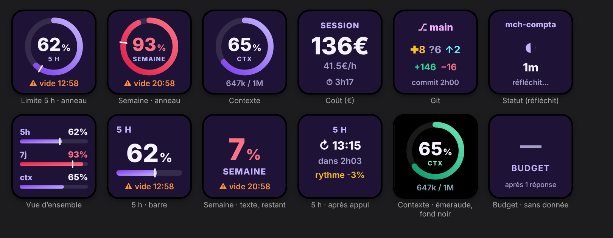
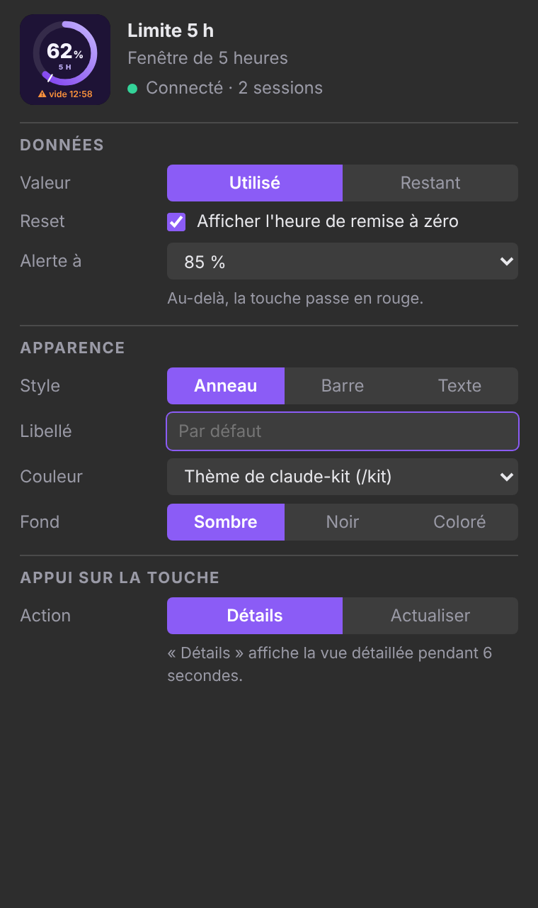

# Claude Kit pour Stream Deck

Tes infos Claude sur les touches de ton Stream Deck, en français et personnalisables touche par touche. Fonctionne avec **l'app Claude (bureau), VS Code et le terminal**, grâce à la bande `kit-band` de claude-kit qui publie l'état de chaque session.



## Installation

1. Installe claude-kit (`node install.js` à la racine du dépôt). Si l'app Stream Deck est installée, le plugin est copié automatiquement.
2. Sinon : double-clique sur [`dist/claude-kit.streamDeckPlugin`](dist/claude-kit.streamDeckPlugin).
3. Redémarre l'app Stream Deck : les actions sont dans la catégorie **Claude Kit**.

macOS 12+ et Windows 10+, application Stream Deck 6.4 ou plus récente.

## Les touches

| Touche | Affiche | Appui (« Détails ») |
|---|---|---|
| **Limite 5 h** | % utilisé (ou restant), repère du temps écoulé, heure de reset ou « ⚠ vide 21:45 » | Heure du reset, temps restant, rythme |
| **Limite semaine** | Idem pour la semaine | Jour du reset, rythme, % disponible par jour |
| **Budget mensuel** | Limite de dépenses, si ton compte en a une | — |
| **Contexte** | Remplissage, « ⚠ /compact » à 80 % | Tokens utilisés et projet |
| **Coût de session** | Coût, coût par heure, durée | Messages et coût par message |
| **Git** | Branche, fichiers modifiés, lignes non commitées, dernier commit | Temps depuis le dernier commit |
| **Statut de Claude** | « Réfléchit… » avec chrono, « Prêt » ou « Inactif », dernier tour | Projet, modèle, nombre de sessions |
| **Vue d'ensemble** | 5 h, semaine et contexte sur une touche | — |

## Réglages de chaque touche



- **Session** : la plus récente, ou un projet précis (pratique avec plusieurs onglets Claude ouverts)
- **Valeur** : utilisé ou restant · **Alerte à** : seuil où la touche passe en rouge
- **Style** : anneau, barre ou texte · **Libellé** personnalisé
- **Couleur** : celle de ton thème `/kit` (par défaut), un des 9 thèmes, ou une couleur libre
- **Fond** : sombre, noir ou coloré · **Devise** : comme claude-kit, $ ou €
- **Appui** : vue détaillée (6 s) ou simple actualisation

## Comment ça marche

La bande `kit-band` écrit dans `~/.claude/claude-kit/` :
- `limits.json` : les dernières limites 5 h / semaine / budget (partagées par toutes les sessions)
- `sessions/<id>.json` : l'état de chaque session (contexte, coût, git, activité)

Le plugin relit ces fichiers chaque seconde (seulement s'ils ont changé) et redessine les touches. Il n'envoie rien sur Internet et ne lit jamais tes identifiants.

## Développement

```bash
node --test streamdeck/test/*.test.js   # tests avec un faux Stream Deck
node streamdeck/build.js                 # refait dist/claude-kit.streamDeckPlugin
```
